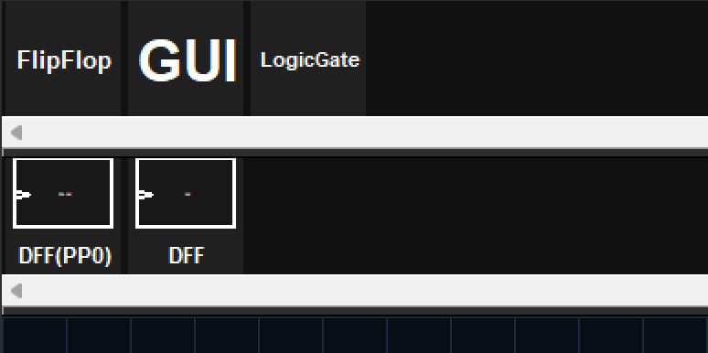
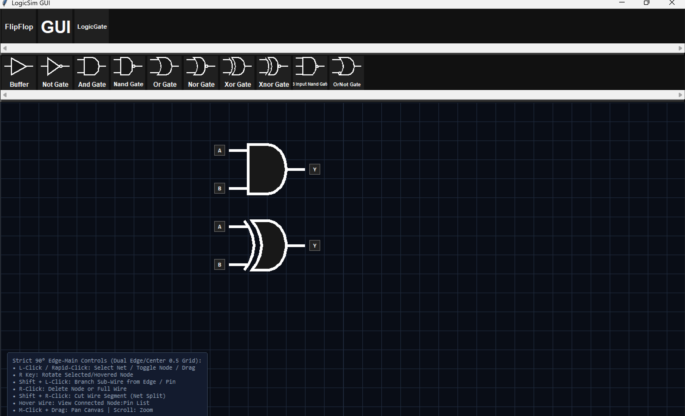
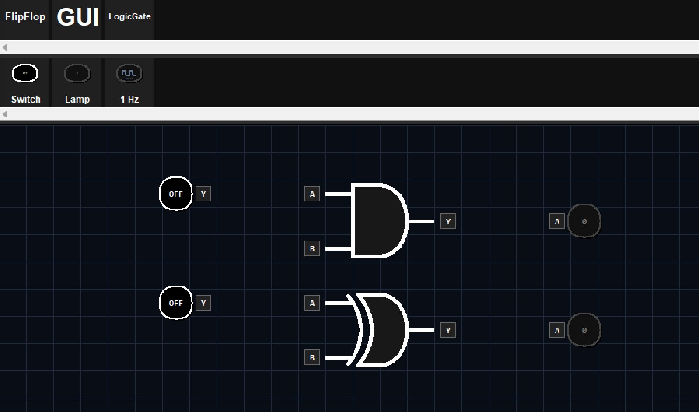
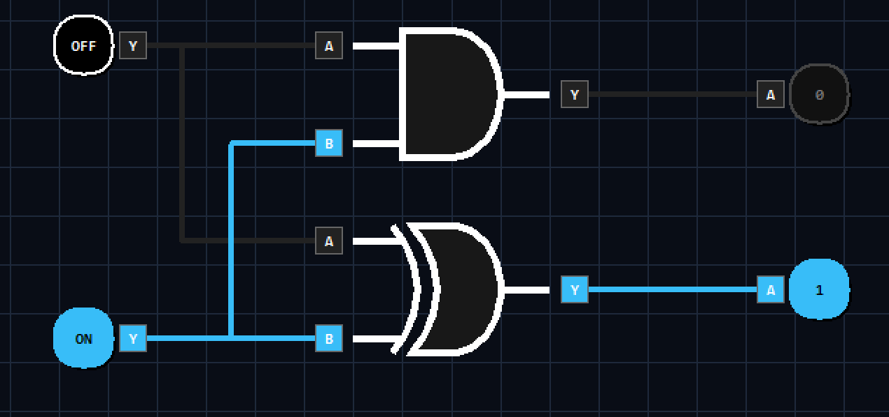
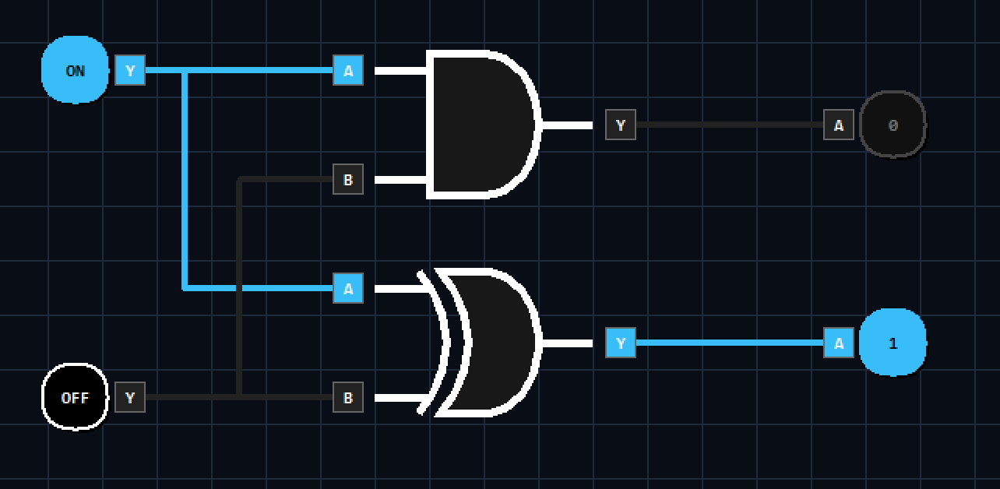
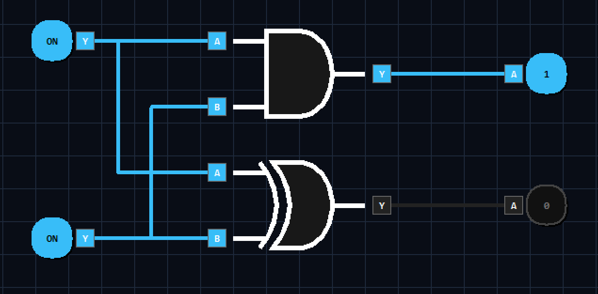
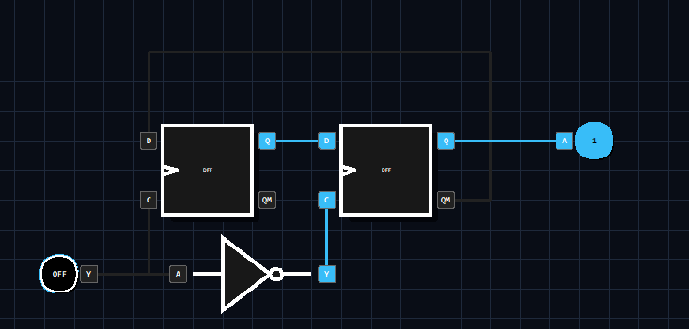

# How to Learn to Build Your First Logic Circuit in LogicSim
### Written by 12zcab
Erm Hello bud.
So I am 12zcab form HackClub,one of the main developers of LogicSim.
Glad that actually somebody read the tutorial LOL

## What you need to know before reading this tutorial
I don't think i can correctly and accurately explain every Logic Circuit stuff as I am just a normal student so yah you should self study these concepts:

1. Boolean Data Type and Binary System
2. Boolean Operations and Truth Tables
3. Logic Gates

## Half Adder
YESSS HALF ADDER
Almost the most popular stuff for Logic Circuit
Half Adder performs a two 1-Bit Binary Addition with two 1-Bit Carry and Value Output.
As we all know, 0b + 0b = 0b , 1b + 0b = 1b , 1b + 1b = 10b , 0b + 1b = 1b
so the Truth Table of it in terms of Carry,Value output and A,B input is:
| A\B | 0   | 1   |
|-----|-----|-----|
| 0   | 0,0 | 0,1 |
| 1   | 0,1 | 1,0 |

Then we can observe that Carry becomes 1 only when A and B are both 1 so we can say Carry = A AND B
Also for Value,it becomes 1 only when A and B are Different so Value = A XOR B

we open LogicSim and pick the Logic Gate Category:

Then we pick XOR and AND Gate from it and place into the Editor

Then we pick the GUI Category and place two Switches and two Lamps as A,B and Carry,Value
Press R when Selected the Node to Rotate it.

Then we can connect the outputs of XOR and the AND Gate to Value and Carry respectively.

Finally we connect the Inputs of XOR and AND Gate,each Gate have two pins connected to A and B Switches respectively.
We use Shift + Left Click on existing Wire to Fork a Branch for the wire.

Finally, we can test this circuit by toggling the input buttons!

## T-Type FlipFlop

Not yet finished
:D