# How to Learn to Build Your First Logic Circuit in LogicSim
### Written by 12zcab
Erm Hello bud.
So I am 12zcab form HackClub,one of the main developers of LogicSim.
Glad that actually somebody read the tutorial LOL

## What you need to know before reading this tutorial
I don't think i can correctly and accurately explain every Logic Circuit stuff as I am just a normal student so yah you should self study these concepts:

1. Boolean Data Type and Binary System
2. Boolean Operations and Truth Tables
3. Logic Gates

## Half Adder
YESSS HALF ADDER
Almost the most popular stuff for Logic Circuit
Half Adder performs a two 1-Bit Binary Addition with two 1-Bit Carry and Value Output.
As we all know, 0b + 0b = 0b , 1b + 0b = 1b , 1b + 1b = 10b , 0b + 1b = 1b
so the Truth Table of it in terms of Carry,Value output and A,B input is:
| A\B | 0   | 1   |
|-----|-----|-----|
| 0   | 0,0 | 0,1 |
| 1   | 0,1 | 1,0 |

Then we can observe that Carry becomes 1 only when A and B are both 1 so we can say Carry = A AND B
Also for Value,it becomes 1 only when A and B are Different so Value = A XOR B

we open LogicSim and pick the Logic Gate Category:

Then we pick XOR and AND Gate from it and place into the Editor

Then we pick the GUI Category and place two Switches and two Lamps as A,B and Carry,Value
Press R when Selected the Node to Rotate it.

Then we can connect the outputs of XOR and the AND Gate to Value and Carry respectively.

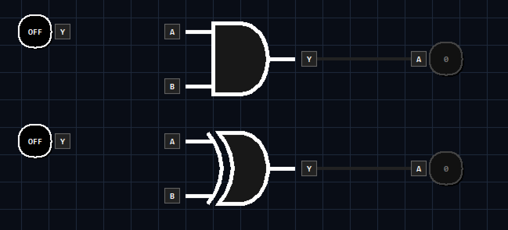

Finally we connect the Inputs of XOR and AND Gate,each Gate have two pins connected to A and B Switches respectively.
We use Shift + Left Click on existing Wire to Fork a Branch for the wire.

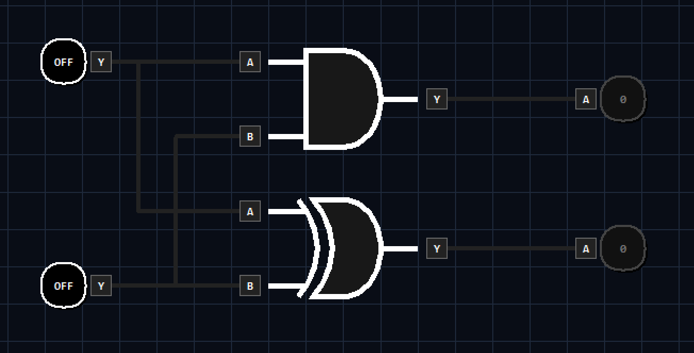

Finally, we can test this circuit by toggling the input buttons!

## Latch

What if we want the Circuit to remember something.?

For this case, we have latches.

There are two main type of latches, NAND based one and NOR based one.

NAND based one are more commonly used but NOR based one is more easy to understand.

Also, there is a more rare type using one OR, one AND, and one NOT Gate.

So right now we want something that can not only remain stable, but can also receive signal to pull it up or down and let it remain stable at that state anytime.

Here, I would like to use a more logical proof instead of just trying,but i really suggest you to try build something that can save state yourself before continuing on this tutorial!

So, first we assume it is only 1 Standalone Gate (BUFFER NOT AND OR XOR NAND NOR XNOR)

We need two function for the latch,first is overriding signal, that can force the output of that  gate to become it, and we also need a feedback signal that make the gate preserve it's own current state.

However, a single gate can only have one output,so that means it can only either preserve the last output or follow the overriding signal, that means it is impossible to build a latch with 1 gate only(include Inverted output gates).

So that means we must use atleast 2 Gates to make a proper latch!

Now, we can consider single input gate first.

For a couple of single input gate, we have three situations.

1. Buffer-Buffer Cycle

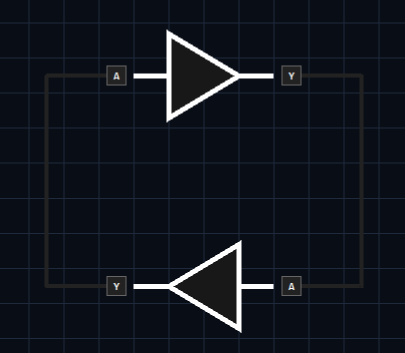

Seems that Buffer-Buffer Cycle can preserve the state right..?

Like if we pullup the cycle...

Oh...

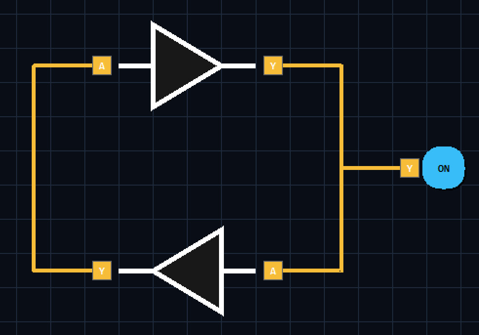

The Orange Wire Status here represents a X(Conflict) Status. This is because the AND Gate is driving the wire to 0 but the input signal want to drive the wire to 1 at the same time.

To solve this problem, we must use an OR gate, which actually allow us to override the status to 1 by inputting 1 to the OR Gate.

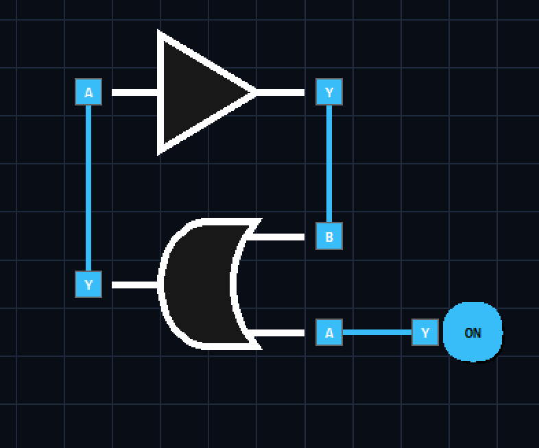

(Note that OR Gate itself actually have an invisible "Buffer" for it output (Buffer is actually just a transparent but have 1 tick delay))

We also want to pull it override the status back to 0 by inputting a signal, so we can add an AND Gate to the loop:

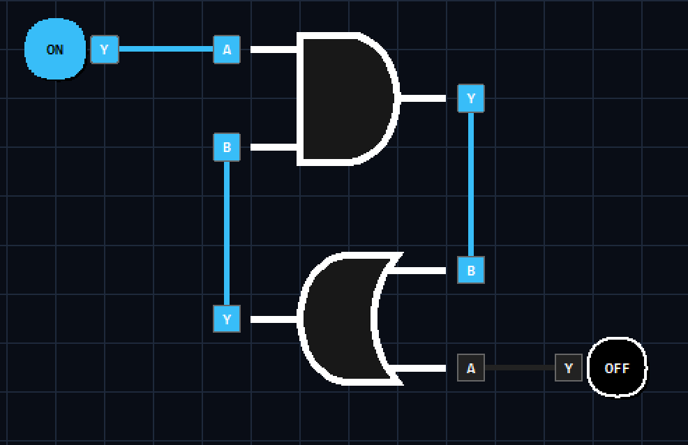

Finally, we want the input to be low-activated so we add a Not Gate for the AND Gate's input.

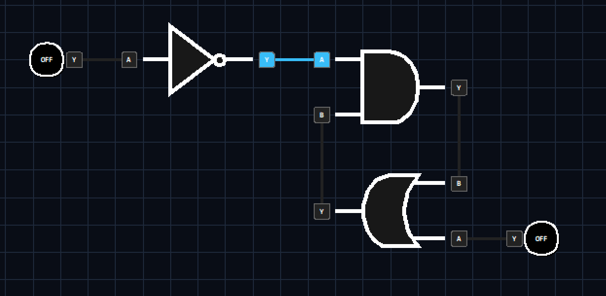

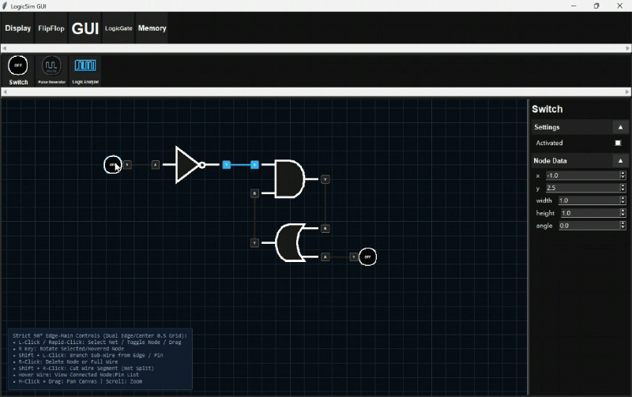

This latch costs 3 Gates but have the benefit that it does not have non-stablized state.

(Btw this latch is formally called as AOI--And Or Invert Latch)

2. BUFFER-NOT Cycle

Welp... It just Blinks and does not stablize

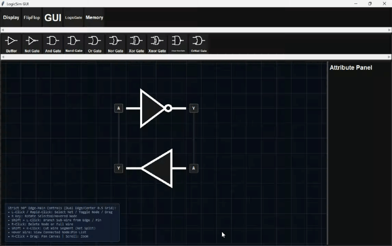

3. NOT-NOT Cycle

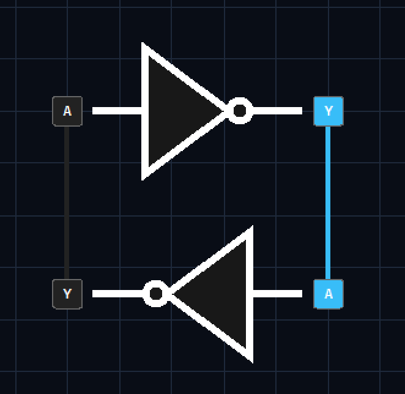

a Not-Not Cycle contain 1 and 0 signal at the same time :O

that means we can pull the 0 to 1 or pull the 1 to 0 to set it or clear it,yayy!

We can either:

1. Pull the side that is originally 1 to 0 to toggle the latch

That means we uses AND Gate!

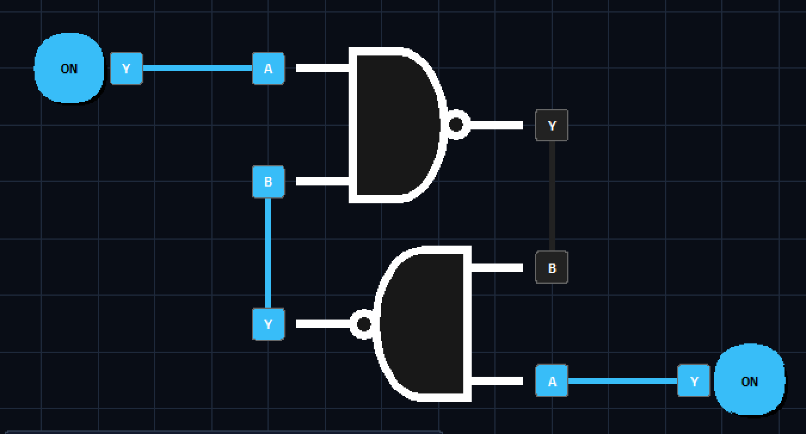

Combining two AND Gate to two Not Gate results in a NAND-Gate Couple Loop.

Note that it pulls the signal if the remaining pin of AND Gate is 0 so that means it is low-activate.

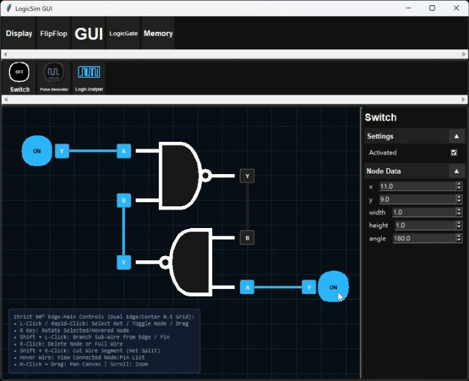

2. Pull the side that is originally 0 to 1 to toggle the latch

That means we uses OR Gate!

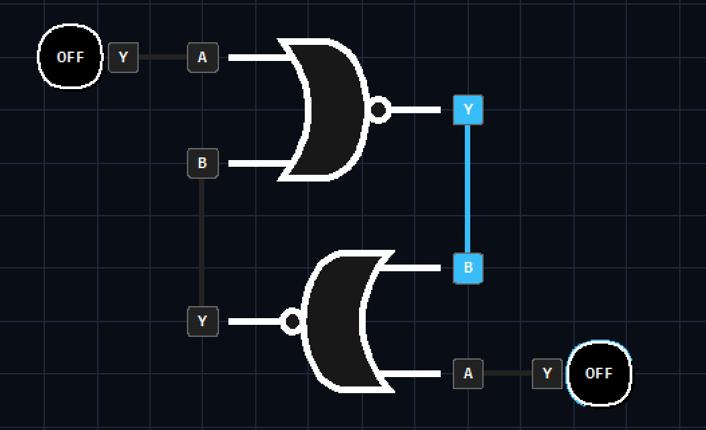

Combining two OR Gate to two Not Gate results in a NOR-Gate Couple Loop.

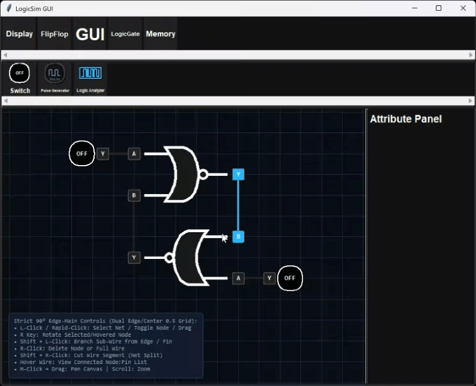

Illegal State VS Metastability

This kinda cross-feedback based circuit usually have illegal state (AOI dont have as it have non-symmetrical priority design)

Illegal State is a situation when the input is out of the designed range, causing the circuit's output to be logically incorrect

For example, when both of a NOR-Latch's set and reset input is 1,both Q and QM output are zero, which is logically incorrect(as Q and QM should always be complimentary)

Illegal State Situation:

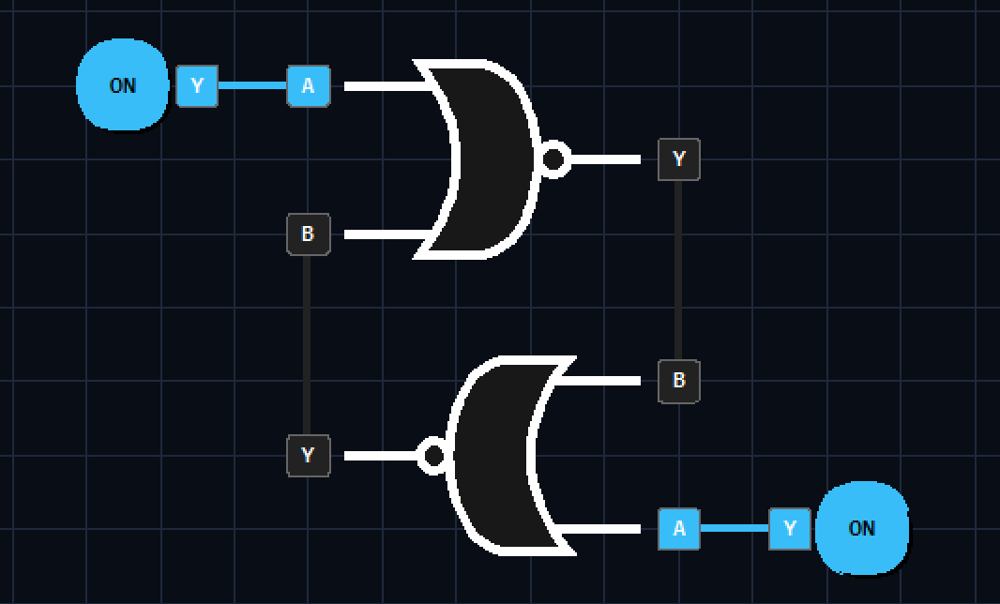

Metastability

Metastability is an unstable state where the output voltage hovers at an intermediate level between a valid logical 0 and 1.

Metastability occurs because the stabilization after an illegal state resulted in a strange abnormal case of equilibrium state,resulting in unpredictable oscillations or abnormal output.

In real life,metastability usually quickly settle back to stable state due to background noise or small delay but in software simulation, it may not be able to stable it self as it reached a perfect equilibrium oscillating state.

Metastability Situation:

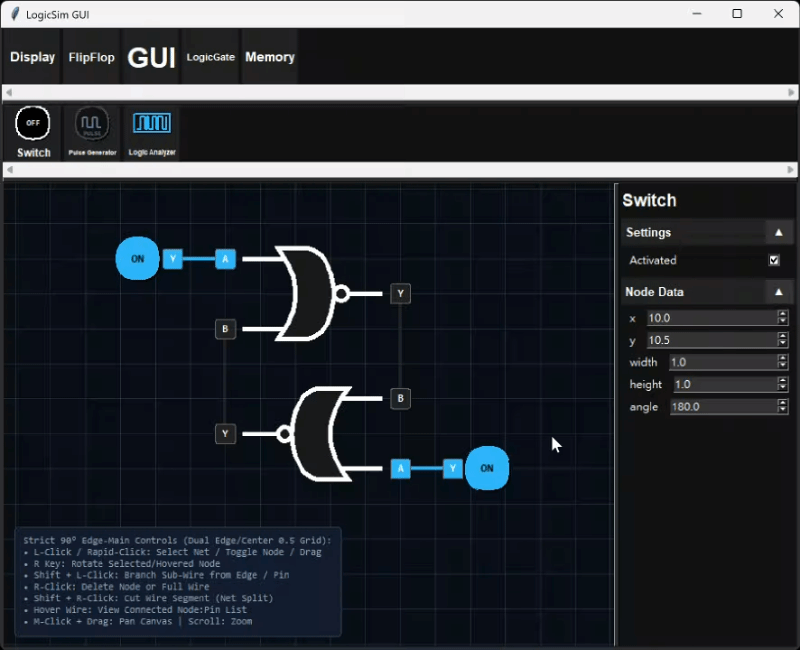

Comparison table:
| Feature / Category | NAND Latches | NOR Latches | AOI Latches |
|-----|-----|-----|-----|
| Metastability or Illegal State | yes, when $S=R=0$ | yes, when $S=R=1$ | No,Set or Reset Signal can be prioritized |
| Activation Level | Low-Activate | High-Activate | Mixed/Depends |
| Gate Count | 2 | 2 | Normally about 8 but can be built as a Single Complex Cell in CMOS Tech. |

# Sorry From Here On the tutorial is not yet finished
## Thanks for viewing this tutorial!
## Contact me in slack @12zcab for any mistake i made in this tutorial or share your idea!

## D-Type FlipFlop
Welp, we have already built a SR(Set,Reset) latch, however the SR latch take the set and reset signal as two input, why cant we use 1 signal for data and use another signal to trigger an override?
Thats exactly what a D-Type FlipFlop does!
In this tutorial I want to mainly focus on NAND Gate based D-Type FlipFlop as it is the most common one (it only uses 1 type of gate and it is low activate.) but is it possible to build a D-type FlipFlop with AND-OR-NOT SR-Latch and NOR SR-Latch too!

## T-Type FlipFlop

Not yet finished
:D

## Counter
Counter is a very very important component in logic circuits!!
For humans we can easily

